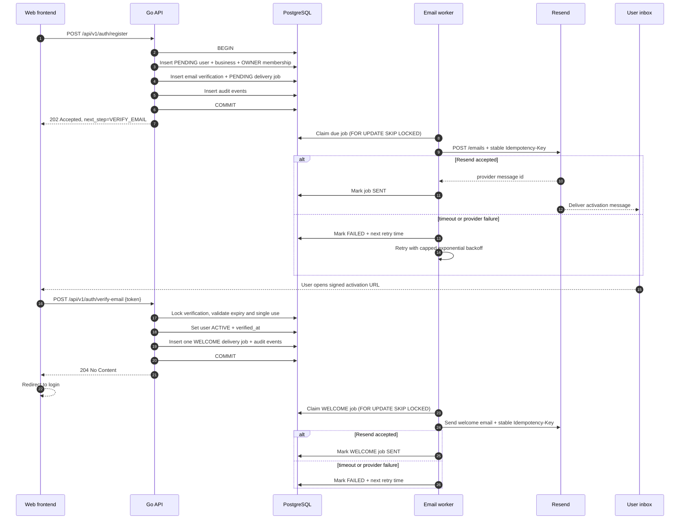

# Technical Architecture, Integrations, AI Models & Operating Cost

**Status:** Architecture Proposal v0.1

**Phase:** Commerce MVP

**Last reviewed:** October 2026

---

# 1. Architecture Objective

The system should support:

- physical merchants
- online merchants
- WhatsApp-first merchants
- future additional communication channels
- sales conversations
- products
- customers
- customer memory
- negotiation
- follow-up
- orders
- future payments
- future domestic/cross-border financial operations

without tightly coupling the business to:

- one AI provider
- one country
- one payment provider
- one messaging provider implementation
- one frontend application

The architecture should initially remain simple enough for a small engineering team.

Therefore:

> **Modular monolith first. Clear domain boundaries from day one.**
> 

---

# 2. High-Level Architecture

```
                         CUSTOMER
                            │
                            │
                      WhatsApp Business
                            │
                            ▼
                 Meta WhatsApp Cloud API
                            │
                         Webhooks
                            │
                            ▼
                  ┌─────────────────────┐
                  │   Webhook Gateway   │
                  └──────────┬──────────┘
                             │
                         Event Layer
                             │
         ┌───────────────────┼──────────────────┐
         │                   │                  │
         ▼                   ▼                  ▼
 Conversation Service   Customer Service   Message Store
         │
         ▼
 Conversation State / Policy Engine
         │
         ▼
                    Agent Orchestrator
                             │
              ┌──────────────┼──────────────┐
              │              │              │
              ▼              ▼              ▼
          Product          Customer       Commerce
           Tools            Tools          Tools
              │              │              │
              └──────────────┼──────────────┘
                             ▼
                      Commerce Domain
               ┌─────────────┼──────────────┐
               ▼             ▼              ▼
            Products       Orders        Pricing
               │             │              │
               └─────────────┼──────────────┘
                             ▼
                      Automation Engine
                             │
                   Queue / Scheduler
                             │
               ┌─────────────┼─────────────┐
               ▼             ▼             ▼
            Follow-up     AI Resume     Daily Summary
```

Future:

```
                       Commerce Domain
                             │
                             ▼
                       Payment Domain
               ┌─────────────┼─────────────┐
               ▼             ▼             ▼
            Collection    Domestic      Cross-border
                           Transfer       Payment
```

---

# 3. Core Architectural Rule

WhatsApp must not become our business logic.

AI must not become our business logic.

The database must not become an unstructured dump.

The architecture should be:

```
Channel
↓
Application
↓
Commerce Domains
↓
Agent
↓
Controlled Tools
```

rather than:

```
WhatsApp
↓
LLM
↓
Database
```

---

# 4. Recommended Stack

## Frontend

### Next.js + TypeScript

Use for:

- merchant onboarding
- product management
- customer records
- order management
- conversation inspection
- settings
- team/admin functionality

### Tailwind CSS

Suitable for fast and consistent development.

### Why

The team already has strong React/Next experience.

We should not introduce a new frontend framework unless there is a concrete business reason.

---

# 5. Backend

## Python + FastAPI

Recommended.

Responsibilities:

- REST APIs
- webhook ingestion
- authentication
- domain logic
- agent orchestration
- automation
- external integrations
- future payment orchestration

### Why FastAPI

It works particularly well with:

- structured APIs
- asynchronous integrations
- AI orchestration
- Python AI ecosystem
- Pydantic validation

---

# 6. Database

## PostgreSQL

Primary system of record.

Store:

- users
- businesses
- memberships
- products
- customers
- conversations
- messages
- orders
- follow-ups
- automation rules
- audit logs
- integration states

PostgreSQL should remain the authoritative commerce database.

---

# 7. Redis

Use Redis for transient infrastructure rather than primary business truth.

Potential use:

- job queue
- short-lived locks
- rate limiting
- temporary conversation locks
- idempotency cache
- scheduled task coordination
- distributed locks

Do not store important permanent merchant state only in Redis.

---

# 8. Background Processing

We need background workers because many product actions happen later.

Examples:

```
follow customer in 2 hours

resume AI after merchant timeout

generate evening summary at 6 PM

retry WhatsApp message

process product image

reconcile Meta connection

request customer feedback after delivery
```

MVP options:

- Celery
- Dramatiq
- ARQ
- another Python queue abstraction

The important thing is not the library.

The important architecture is:

```
API
↓
Job Queue
↓
Worker
↓
Domain Service
```

---

# 9. File / Image Storage

Product images should not live directly inside PostgreSQL.

Use object storage.

Examples:

- S3-compatible object storage
- Cloudflare R2
- AWS S3

Store database references such as:

```
original_image_url
processed_image_url
thumbnail_url
```

Original images should be retained.

---

# 10. Third-Party Integration Strategy

We should deliberately decide:

> BUILD vs BUY.
> 

We build the core commerce intelligence.

We should generally buy infrastructure that is already difficult, regulated or highly standardized.

---

# 11. Meta WhatsApp Business Platform

## Purpose

This is the most important third-party integration in the Commerce MVP.

Use it for:

- merchant WhatsApp connection
- incoming customer messages
- outgoing messages
- delivery/read statuses
- templates
- coexistence
- message events

Meta describes the WhatsApp Business Platform as including its APIs, including Meta-hosted Cloud API.

---

## Architecture

```
Merchant WhatsApp Business
        │
        ▼
Meta WhatsApp Platform
        │
        ▼
Webhook Gateway
        │
        ▼
Conversation Service
```

---

## Important Policy Constraint

Within the customer-service window after a user message, businesses can respond normally. Outside that window, business-initiated messaging generally requires approved templates under WhatsApp's business messaging rules. WhatsApp also expects automated experiences to provide a clear escalation route to human support.

This directly affects our:

- follow-up engine
- broadcast feature
- abandoned-cart recovery
- customer re-engagement

Therefore the Follow-Up service must understand:

```
last_customer_message_at
messaging_window_state
template_required
customer_consent
```

---

# 12. Do We Use Meta Directly or a BSP?

Two approaches exist.

## Option A — Direct Meta Cloud API

Advantages:

- fewer middlemen
- lower platform dependency
- greater implementation control
- potentially better unit economics

Disadvantages:

- we own more onboarding/integration complexity
- Meta platform knowledge required
- support burden is ours

## Option B — Business Solution Provider / Tech Provider

Advantages:

- easier onboarding in some cases
- additional support
- abstractions around Meta

Disadvantages:

- extra cost
- vendor dependency
- less control
- another failure layer

## Proposed Direction

For the MVP:

> investigate direct Meta integration first.
> 

Only add a BSP when there is a concrete operational or eligibility reason.

Do not introduce another provider simply because integration looks easier initially.

---

# 13. AI Provider Architecture

Do not tie the product directly to one model.

Create an abstraction.

```
AIProvider

classify()
extract()
reason()
generate()
vision()
```

Possible providers can be plugged in later.

---

# 14. Model Routing

Do not send every task to the most powerful model.

Different tasks require different intelligence.

This is one of the largest cost-control opportunities.

Recommended architecture:

```
Incoming request
      ↓
Task Router
      ↓
┌─────────────┬──────────────┬──────────────┐
│ Cheap/Fast  │ Standard     │ Complex      │
│ Model       │ Model        │ Reasoning    │
└─────────────┴──────────────┴──────────────┘
```

---

# 15. Model Classes

## Tier 1 — Cheap / High Volume

Use for:

- intent classification
- structured extraction
- routing
- simple rewriting
- basic product matching
- language detection

A cost-efficient model should handle these.

Current OpenAI guidance positions GPT-6 Luna for cost-sensitive high-volume workloads. Its published standard API pricing is $0.10 per million input tokens and $0.50 per million output tokens.

---

## Tier 2 — Commerce Conversation Model

Use for:

- normal customer conversation
- product recommendations
- follow-up wording
- merchant summaries
- moderately complex sales reasoning

A stronger but still economical model is appropriate.

Current examples include GPT-6.1 Terra at $1/M input and $5/M output.

---

## Tier 3 — Complex Reasoning

Use rarely.

Examples:

- ambiguous multi-product negotiation
- complex merchant instructions
- difficult conversation recovery
- high-value business reasoning

GPT-6.1 Sol is currently priced around $2/M input and $10/M output at standard rates.

---

# 16. Do Not Hardcode These Models

Use configuration:

```
INTENT_MODEL=gpt-6-luna
COMMERCE_MODEL=gpt-6.1-terra
REASONING_MODEL=gpt-6.1-sol
```

Then changing models becomes configuration rather than an architectural rewrite.

---

# 17. Agent Architecture

We should not build one massive agent.

We should have specialized capabilities with controlled tools.

---

# 18. Customer Commerce Agent

Purpose:

> help customers buy from the merchant.
> 

Allowed responsibilities:

- understand customer intent
- search products
- answer product questions
- provide prices
- negotiate within policy
- collect required order information
- identify purchase intent
- initiate follow-up
- escalate

Tools:

```
search_products
get_product
get_product_availability
get_pricing_policy

get_customer
get_customer_history

get_business_information

create_order_draft

schedule_followup

request_merchant_decision

escalate_conversation

send_message
```

---

# 19. Merchant Assistant

Purpose:

> help merchant understand and operate the business.
> 

Example requests:

> “Who needs follow-up?”
> 

> “Add this product.”
> 

> “How many people asked about washing machines today?”
> 

> “What happened today?”
> 

Tools may include:

```
create_product_draft
search_customers
get_customer
list_followups
approve_followup
get_orders
get_daily_summary
```

Future financial tools:

```
get_balance
get_payments
create_supplier_payment_request
get_fx_quote
```

---

# 20. The Two Agents Must Not Have the Same Permissions

For example:

Customer Commerce Agent:

```
CAN:
read public product information
create order draft
send customer message
schedule safe follow-up

CANNOT:
view merchant balance
transfer funds
change minimum price
issue refund
```

Merchant Assistant:

```
CAN:
view merchant business records
modify products with permission
approve follow-up

FUTURE:
initiate payment workflows
```

This is an important security boundary.

---

# 21. Agent Execution Loop

Recommended architecture:

```
Customer Message
↓
Normalize message
↓
Check conversation state
↓
Check AI permission
↓
Retrieve compact context
↓
Agent reasons
↓
Agent selects tool
↓
Application validates tool permission
↓
Tool executes
↓
Tool returns structured result
↓
Agent generates customer response
↓
Final policy validation
↓
Send
↓
Audit
```

---

# 22. Context Design

Do not send the entire customer's lifetime chat history to the LLM every time.

This increases:

- cost
- latency
- hallucination risk
- context pollution

Instead use layered memory.

```
Current conversation messages
+
conversation summary
+
relevant customer facts
+
relevant product information
+
merchant rules
```

---

# 23. Customer Memory Architecture

Use structured memory rather than only embeddings.

Example:

```
CustomerProfile
- name
- last_purchase
- total_orders
- last_interaction
```

```
CustomerInterest
- product_id
- first_seen
- last_seen
- status
```

```
CustomerSummary
- compact AI-generated summary
```

Embeddings can be introduced later for semantic search where useful.

---

# 24. Do We Need a Vector Database?

Not initially for core commerce.

PostgreSQL handles most of our structured retrieval.

Potential future use:

- merchant knowledge documents
- large product catalogue semantic search
- historical conversation retrieval
- FAQs

If needed:

> pgvector
> 

is enough initially.

Do not add Pinecone/Weaviate/etc. before there is a demonstrated need.

---

# 25. Deterministic Policy Engine

This is one of the most important services.

Example:

```
Agent:
"Customer offered ₦18,000."

Policy engine:
asking_price = 23,000
minimum_price = 20,000

Result:
REJECT_OR_COUNTER
```

The LLM may determine how to phrase the response.

It does not determine whether ₦18,000 is acceptable.

---

# 26. Conversation State Machine

Recommended:

```
AI_HANDLING
     │
     ├──── merchant responds ────> HUMAN_HANDLING
     │
     ├──── agent uncertain ──────> WAITING_FOR_MERCHANT
     │
     └──── sensitive issue ──────> ESCALATED

HUMAN_HANDLING
     │
     └──── approved resume ──────> AI_HANDLING
```

The state machine belongs in application code.

---

# 27. Event Architecture

Important changes should emit events.

Examples:

```
MESSAGE_RECEIVED
PRODUCT_INTEREST_DETECTED
PRICE_SENT
NEGOTIATION_STARTED
HUMAN_TAKEOVER
FOLLOWUP_DUE
ORDER_CREATED
ORDER_DELIVERED
```

For MVP, these events can exist inside the same application.

We do not need Kafka.

A database-backed outbox + worker is enough.

---

# 28. Transactional Outbox Pattern

Useful for reliability.

Example:

Order transaction:

```
BEGIN

create order
create ORDER_CREATED outbox event

COMMIT
```

Background worker processes:

```
ORDER_CREATED
```

This prevents:

> order committed but event lost.
> 

This will become especially important when payments arrive.

---

# 29. Product Image AI

We have two distinct tasks:

## Vision / Extraction

Understand:

- product type
- visible attributes
- colour
- potential category

This can be done by multimodal language models.

## Image Enhancement

Create a more presentable version.

Use a dedicated image-generation/editing model.

OpenAI currently recommends GPT Image 2.5 Sunburst for high-precision editing and Flare for faster everyday generation/editing.

For MVP, we should prioritize:

> accuracy over artistic generation.
> 

We are editing merchant product images, not creating imaginary product advertisements.

---

# 30. Image Cost Control

Do not automatically generate four versions for every uploaded product.

Possible flow:

```
Merchant uploads image
↓
Create thumbnail automatically
↓
Merchant clicks "Improve image"
↓
Generate ONE improved version
↓
Merchant approves
```

OpenAI currently lists GPT Image 2 at roughly $0.053 output cost for a medium-quality 1024×1024 image, before applicable input-token cost. High-quality output can be materially more expensive.

Therefore image processing should probably have:

- limits
- credits
- tiering

rather than unlimited generation.

---

# 31. Authentication

MVP options:

- phone + OTP
- email + OTP
- secure password authentication
- session cookies/JWT depending frontend architecture

Phone-based identity may align better with the merchant experience.

But merchant identity must remain separate from WhatsApp platform authorization.

---

# 32. Authorization

Use RBAC.

Example roles:

```
OWNER
MANAGER
STAFF
```

Example:

```
OWNER:
everything

MANAGER:
products
customers
orders
conversations

STAFF:
assigned conversations
limited orders
```

Future financial permissions should be separate.

For example:

```
CAN_VIEW_BALANCE
CAN_CREATE_PAYMENT
CAN_APPROVE_PAYMENT
```

Do not equate:

> employee
> 

with:

> allowed to move money.
> 

---

# 33. Observability

Because AI and external messaging are involved, basic logging is insufficient.

We should be able to trace:

```
Webhook received
↓
Customer matched
↓
Conversation loaded
↓
Model called
↓
Tool selected
↓
Tool result
↓
Policy decision
↓
Message sent
↓
Meta delivery event
```

Use correlation IDs.

Example:

```
request_id
conversation_id
agent_run_id
external_message_id
```

---

# 34. Agent Audit Record

Consider:

```
AgentRun
- id
- business_id
- conversation_id
- model
- input_tokens
- output_tokens
- tools_called
- outcome
- latency
- estimated_cost
- created_at
```

This is important for both:

- debugging
- economics

---

# 35. Cost Architecture

Operational cost should be treated as a product feature.

Every merchant generates variable usage.

Main cost categories:

```
AI inference
WhatsApp messaging
image processing
compute
database
Redis/queue
storage
bandwidth
observability
support
```

Later:

```
payment provider fees
KYC/KYB
FX
bank transfers
fraud services
```

---

# 36. AI Cost Example

Assume one agent turn averages:

```
2,000 input tokens
150 output tokens
```

For 1,000 agent turns:

## GPT-6 Luna

Input:

```
2M × $0.10/M
= $0.20
```

Output:

```
150K × $0.50/M
= $0.075
```

Approximate total:

> **$0.275 / 1,000 turns**
> 

using current published rates.

---

## GPT-6.1 Terra

```
2M × $1
= $2

150K × $5
= $0.75
```

Approx:

> **$2.75 / 1,000 turns**
> 

---

## GPT-6.1 Sol

```
2M × $2
= $4

150K × $10
= $1.50
```

Approx:

> **$5.50 / 1,000 turns**
> 

---

# 37. Why Model Routing Matters

Imagine:

```
100,000 agent turns/month
```

Approximate model cost under the same token assumptions:

```
Luna:
~$27.50

Terra:
~$275

Sol:
~$550
```

Therefore:

> putting every customer message through the strongest model is bad architecture.
> 

A much better architecture:

```
70% cheap model
25% standard model
5% complex model
```

The percentages should eventually come from production measurements.

---

# 38. Prompt Caching

Repeated information such as:

- system rules
- tool descriptions
- policy instructions

may benefit from provider caching mechanisms where supported.

OpenAI currently provides lower pricing for cached input across its main model families.

Our agent architecture should therefore keep stable instructions stable rather than reconstructing entirely different giant prompts on every request.

---

# 39. WhatsApp Cost

WhatsApp cannot be treated as free.

Costs depend on:

- country
- message category
- customer-service window
- whether the business initiates communication
- applicable current Meta pricing

Meta's business policy specifically distinguishes ordinary responses within the customer service window from business-initiated template messaging outside it.

Therefore our database should track cost-relevant messaging context.

Example:

```
MessageCostRecord
- business_id
- customer_id
- message_id
- category
- template_id
- provider_cost
- timestamp
```

This gives us visibility before introducing merchant billing.

---

# 40. Follow-Up Cost Control

Follow-up is particularly important because:

> it can generate revenue
> 
> 
> but it can also generate WhatsApp and AI cost.
> 

The system should eventually evaluate:

```
expected commercial value
vs
messaging cost
```

For example:

Do not spend repeatedly following up a low-value customer ten times.

Frequency limits are required for:

- economics
- customer experience
- WhatsApp reputation

---

# 41. Infrastructure Cost

For initial pilot scale, infrastructure should remain small.

Likely services:

```
1 API service
1 worker
1 PostgreSQL database
1 Redis instance
object storage
frontend hosting
```

You do not need:

- Kubernetes
- Kafka cluster
- Elasticsearch cluster
- service mesh
- multiple microservices

for 3–4 pilot merchants.

---

# 42. Hosting Strategy

Two reasonable stages:

## Pilot

Managed infrastructure.

For example:

- Vercel — frontend
- Render / Railway / Fly / similar — backend
- managed PostgreSQL
- managed Redis
- object storage

Benefits:

- small DevOps burden
- quick deployments
- easier developer onboarding

Render, for example, currently supports web services, background workers, PostgreSQL, Redis-compatible key-value services and cron/workflow functionality in one managed platform.

---

## Growth

As load and economics justify it:

- AWS
- GCP
- Azure
- larger managed infrastructure

Do not migrate because a cloud architecture diagram looks more professional.

Migrate when economics, compliance or scale justify it.

---

# 43. Cost Ledger

We should build internal cost tracking early.

For each business:

```
MerchantUsage
- ai_input_tokens
- ai_output_tokens
- AI_cost
- images_generated
- image_cost
- WhatsApp_messages
- WhatsApp_cost
- storage
```

Then we can calculate:

```
Gross Margin Per Merchant
=
subscription revenue
-
variable merchant costs
```

Without this data, pricing decisions become guesses.

---

# 44. Example MVP Cost Model

Suppose one merchant generates:

```
2,500 agent turns/month
10 product image enhancements/month
moderate WhatsApp activity
```

Using mostly low-cost models:

AI may remain relatively inexpensive.

For example, at the Luna example above:

```
2,500 turns
≈ $0.69
```

before additional agent/tool/provider costs.

Ten medium GPT Image 2 outputs would be roughly:

```
10 × $0.053
≈ $0.53
```

plus input processing.

So the bigger variable cost may eventually become:

> WhatsApp outbound messaging + support + infrastructure + payment provider costs
> 

rather than raw LLM tokens.

This is why we should not assume:

> “AI is too expensive.”
> 

Measure it.

---

# 45. Operational Cost Categories

Track separately:

## Fixed

- hosting
- database
- monitoring
- domain
- developer tooling

## Variable per merchant

- AI tokens
- image generation
- WhatsApp messaging
- storage
- bandwidth

## Variable per transaction — later

- payment provider
- bank transfer
- FX
- KYC/KYB
- settlement

This separation is essential for pricing.

---

# 46. Third-Party Integrations — MVP

Required:

### Meta WhatsApp Business Platform

Core channel.

### AI Provider

Reasoning, extraction and generation.

### Image Processing Provider

For product improvement.

### Object Storage

Product images/media.

### Email / Notification Provider

For account/admin notifications if needed.

Possible:

- Resend
- Postmark
- SES

### Error Monitoring

Examples:

- Sentry

### Product Analytics

Possible later:

- PostHog

But do not overload the MVP with analytics platforms.

---

# 47. Third-Party Integrations — Later

## Payments

Provider abstraction.

```
PaymentProvider
```

could later connect to:

- Nigerian payment providers
- banking infrastructure
- cross-border providers
- stablecoin settlement providers

## Identity / KYC

Only when financial features require it.

## Logistics

Only after merchant research proves value.

---

# 48. What We Build Ourselves

Our differentiation should live in:

### Commerce Engine

Understanding:

```
customer
+
product
+
conversation
+
intent
+
order
```

### Merchant Memory

Understanding the business over time.

### Sales State

Knowing where a customer is in the purchase journey.

### Follow-Up Intelligence

Knowing:

> who to contact
> 
> 
> when
> 
> why
> 
> about what
> 

### Merchant Assistant

Natural-language business operation.

### Commerce Policies

Pricing, negotiation, escalation and merchant controls.

That is our intellectual product.

---

# 49. What We Should NOT Build Ourselves

Initially:

- messaging infrastructure
- foundational LLM
- image-generation model
- cloud storage
- email infrastructure
- bank rails
- KYC infrastructure

Use providers.

Our engineering time should go toward the part merchants actually pay us for.

---

# 50. Recommended Repository Structure

Potential monorepo:

```
/apps
   /web
   /api
   /worker

/packages
   /shared-types
   /ui

/docs
```

Backend:

```
app/
├── auth/
├── users/
├── businesses/
├── integrations/
│   └── whatsapp/
├── customers/
├── conversations/
├── products/
├── pricing/
├── orders/
├── followups/
├── automation/
├── agents/
│   ├── commerce/
│   └── merchant/
├── audit/
└── shared/
```

---

# 51. Architecture Progression

## Stage 1 — 3–4 merchants

```
Next.js
FastAPI
Postgres
Redis
Worker
Meta Cloud API
AI provider
Object storage
```

Perfectly sufficient.

---

## Stage 2 — Hundreds of merchants

Improve:

- worker concurrency
- queue reliability
- database indexes
- caching
- observability
- model routing
- cost tracking

Still potentially a modular monolith.

---

## Stage 3 — Thousands / high traffic

Only then evaluate extracting:

```
Messaging Service
Agent Service
Automation Service
Payment Service
```

based on actual bottlenecks.

---

# 52. Architecture Principle

Our architecture should optimize for:

> **clarity first, correctness second, reliability third, scale when evidence requires it.**
> 

Not:

> “What architecture would a billion-dollar company use?”
> 

The system should be understandable by a new developer joining the team.

A developer should be able to identify:

```
What domain am I changing?

What data owns the truth?

Which event is produced?

Can AI perform this action?

What policy controls it?

Which external system is involved?

What happens if that system fails?

What does this action cost us?
```

If the architecture makes those questions easy to answer, we have a strong foundation.
# Browser registration and email activation

The browser registration path uses PostgreSQL as a durable job queue. This
keeps Resend latency out of the HTTP request while guaranteeing that a
committed web account always has a committed delivery job. A `PENDING` account
cannot authenticate.



The job claim uses a processing lease, so another process can recover work
after a crash. Multiple API instances can run workers concurrently because
claims use `SKIP LOCKED`. The stable provider idempotency key also protects the
ambiguous case where Resend accepted a message but the worker crashed before
recording `SENT`. A unique `(verification_id, job_type)` database constraint,
together with the verification-row lock and single transaction, ensures that
concurrent or repeated verification requests cannot queue duplicate welcome
emails.

Email purpose is explicit in the durable job. Security messages such as email
verification use `RESEND_SECURITY_FROM_EMAIL`; lifecycle messages such as the
welcome email use `RESEND_LIFECYCLE_FROM_EMAIL`. Templates and purpose routing
remain separate from the Resend HTTP client. Provider calls happen only after
the activation transaction commits, so provider availability never determines
whether a valid account activation succeeds.

